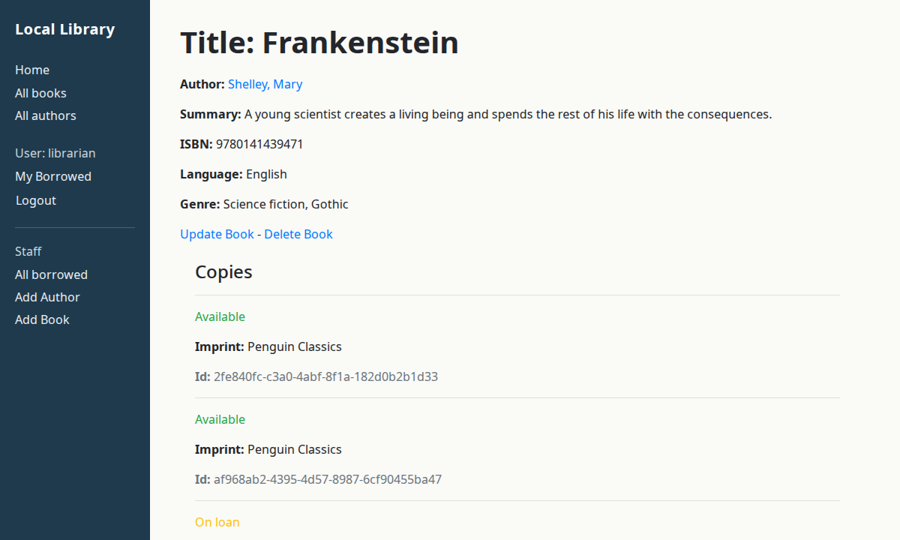
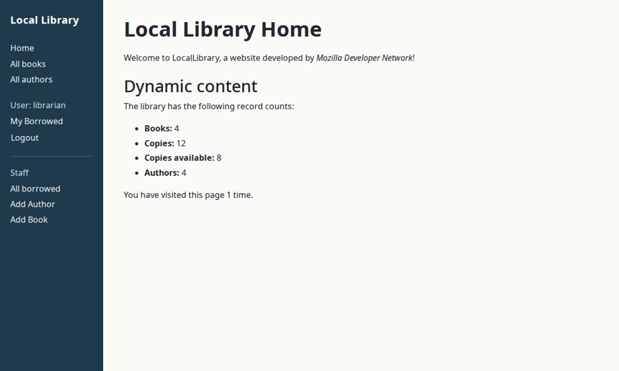
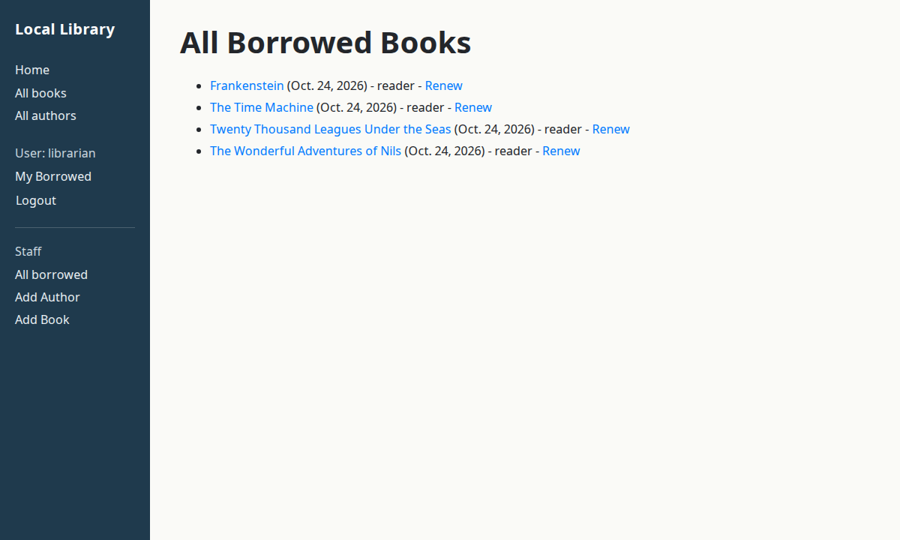

# Local Library

My first Django project (2020): a small library catalogue with books, authors and copies, user accounts, and a staff role that can see every loan and renew books. Built by following Mozilla's [Django tutorial](https://developer.mozilla.org/en-US/docs/Learn/Server-side/Django/Tutorial_local_library_website), then refreshed in 2026 to run on current Django.



## What it does

- Catalogue of books, authors, genres and languages, with list and detail pages
- Copies (book instances) with status and due dates
- Log in, log out, password reset (emails print to the console)
- Readers see their own loans; librarians see all loans and can renew them
- Staff forms to add, edit and delete authors and books
- 37 tests for models, forms and views

## Run it

```bash
python -m venv .venv && . .venv/bin/activate
pip install -r requirements.txt
python manage.py migrate
python manage.py seed_demo      # sample books, a librarian and a reader
python manage.py runserver
```

Log in as `librarian` or `reader` with password `demo-pass-2026` (demo data only).

```bash
python manage.py test
```

<p>
  
  
</p>

## 2026 refresh

- Django 3.0 → 5.2 LTS: removed `ugettext`, logout as a POST form, updated test assertions
- Settings from environment variables (`DJANGO_SECRET_KEY`, `DJANGO_DEBUG`, `DJANGO_ALLOWED_HOSTS`); no secret in the code
- `seed_demo` command so a fresh install has something to show
- A light visual polish of the sidebar and typography
